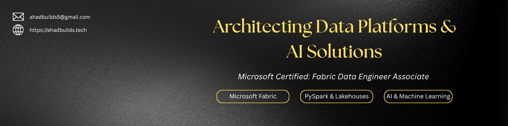
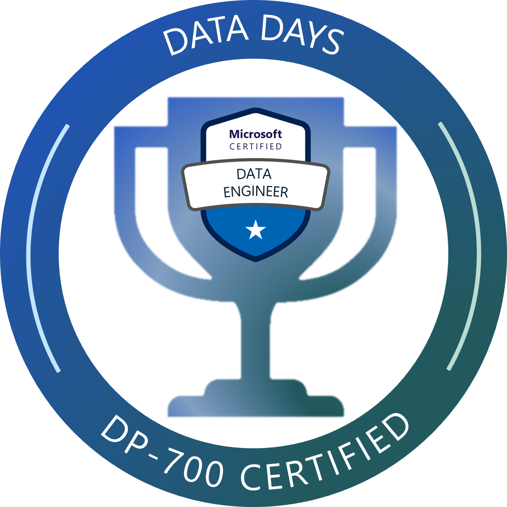
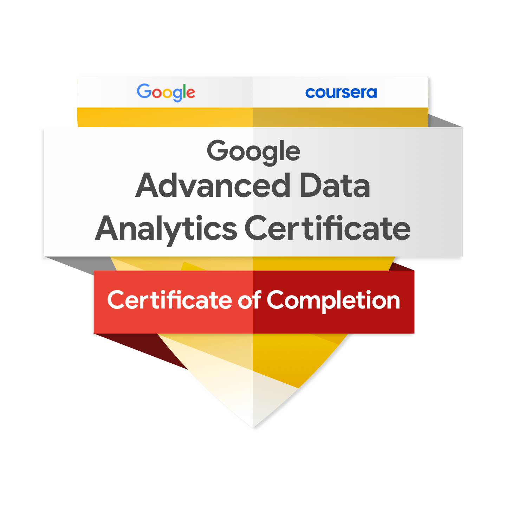
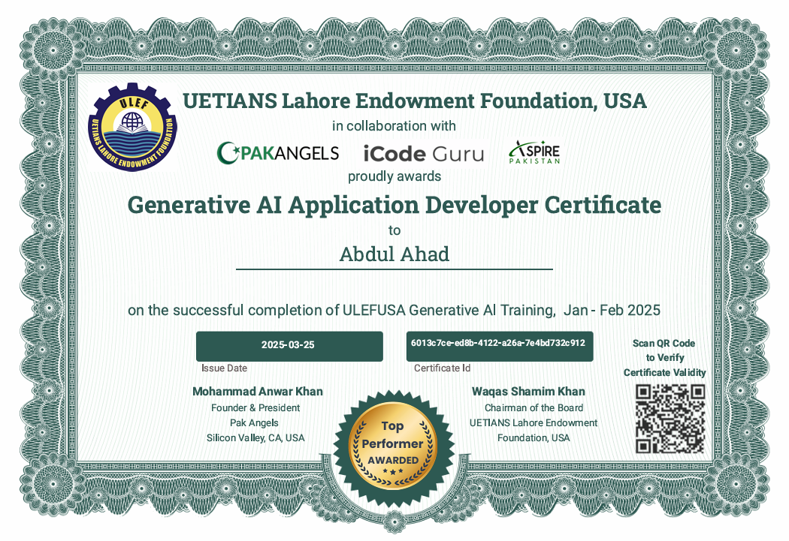

 

 

 

 

**Engineering data systems. Building intelligent applications. Turning data into decisions.**

---

## About Me

I'm **Abdul Ahad**, a Computer Science student at the **University of Engineering & Technology (UET), Lahore**, specializing in modern data engineering and intelligent software systems.

My primary focus is **Data Engineering**: building data pipelines, transforming raw data into reliable analytical datasets, and developing scalable lakehouse solutions.

I also work across machine learning, data science, and backend development to connect data infrastructure with practical AI applications.

<table>
<tr>
<td width="50%" valign="top">

### ◈ Data Engineering

- Modern data platforms
- ETL / ELT pipelines
- Lakehouse architecture
- SQL and PySpark transformations
- Data modeling and analytics

</td>
<td width="50%" valign="top">

### ◈ AI & Intelligent Systems

- Machine learning
- Predictive analytics
- Feature engineering
- AI-powered applications
- REST API development

</td>
</tr>
</table>

`Microsoft Fabric` · `SQL` · `PySpark` · `Power BI` · `Python`

---

## Technical Stack

### Data Engineering & Cloud

### Artificial Intelligence & Machine Learning

### Data Science & Business Intelligence

### Backend & Application Development

### Development Tools

---

## Featured Projects

<table>
<tr>
<td width="50%" valign="top">

<h3 align="center">SMARTMINER</h3>

An AI-powered data mining platform combining data preprocessing, exploratory analysis, clustering, dimensionality reduction, and predictive modeling.

**Technologies**

`Python` `React` `FastAPI` `TensorFlow`

</td>
<td width="50%" valign="top">

<h3 align="center">CardioPulse AI</h3>

A heart disease prediction and analytics system featuring data preprocessing, exploratory analysis, classification models, and interactive business intelligence dashboards.

**Technologies**

`Python` `Pandas` `Scikit-learn` `Power BI`

</td>
</tr>

<tr>
<td width="50%" valign="top">

<h3 align="center">Air Pollution Detection</h3>

An environmental data analytics project exploring air-quality datasets, identifying pollution patterns, and generating analytical insights.

**Technologies**

`Python` `Pandas` `Scikit-learn` `Visualization`

</td>
<td width="50%" valign="top">

<h3 align="center">Blockchain Prescription Verification</h3>

A healthcare application designed to support prescription verification and tamper-resistant records using blockchain technology.

**Technologies**

`Blockchain` `Solidity` `Web Development`

</td>
</tr>
</table>

### Other Work

**ATHLEIMAX** — Commercial sportswear website featuring responsive design, product categorization, and SEO optimization.

---

# Certifications & Credentials

  

 

### Microsoft Certified: Fabric Data Engineer Associate

 

`DP-700` · Microsoft · 2026

 

---

## Additional Credentials

<table>
<tr>
<td align="center" width="50%" valign="top">

### Google Advanced Data Analytics

Google · Coursera · 2025

</td>
<td align="center" width="50%" valign="top">

### Google Business Intelligence

Google · Coursera · 2025

</td>
</tr>

<tr>
<td align="center" colspan="2">

 

### Generative AI Application Developer

ULEFUSA · Pak Angels · March 2025

</td>
</tr>
</table>

---

---

## GitHub Activity

---

## Education

**Bachelor of Science in Computer Science**

University of Engineering & Technology (UET), Lahore

Expected Graduation: **2027**

---

## Let's Connect

Interested in **Data Engineering, Microsoft Fabric, AI/ML, and data-driven systems**.

Open to relevant internships, entry-level opportunities, and collaborative technical projects.

 

  

<a href="mailto:ahadbuilds5@gmail.com">ahadbuilds5@gmail.com</a>

  

Building reliable data systems and intelligent applications.

